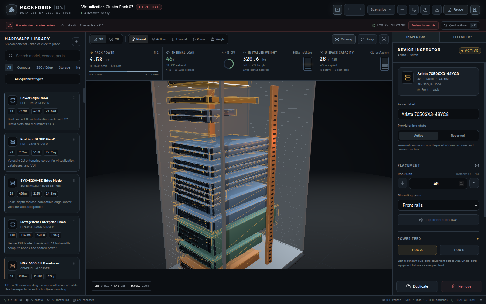

# RackForge

**A professional browser-based 3D/2.5D server-rack and data-center digital twin.**

RackForge helps infrastructure engineers, homelab builders, and IT planners design rack layouts, verify hardware placement, visualize airflow and hotspots, and budget power, heat, redundancy, and structural load before touching physical equipment.



[](https://react.dev) [](https://www.typescriptlang.org) [](https://threejs.org) [](https://tailwindcss.com) [](#privacy)

---

## Why RackForge

- **See the rack before you rack it.** A dimensionally scaled 3D cabinet, perforated front/rear doors, removable panels, cutaway and X-ray modes, and a precision 2D elevation editor.
- **Use real hardware rules.** 19-inch mounting, U-height snapping, front/rear planes, 0U vertical accessories, collision checks, width and depth clearance, reserved zones, and cable-clearance validation.
- **Understand airflow.** Front-to-back, back-to-front, side-to-side, and passive profiles; animated 3D streamlines, intake/exhaust gradients, recirculation, bypass, hotspots, fan rotors, thermal plumes, and correctly separate 2D elevation semantics.
- **Model the consequences.** Typical, peak, and rated power; BTU/h; monthly and annual energy; PDU A/B; breaker limits; N/N+1/2N redundancy; cooling headroom; weight; rolling/static load; and center of gravity.
- **Keep control of work.** Local autosave, 80-step undo/redo, reusable custom hardware, four production-oriented scenarios, JSON import/export, command palette, keyboard access, and printable reports.

## Screenshot

The included image is generated from a clean production build using the default **Enterprise Virtualization 42U** scenario. Rebuild it with `npm run build`, serve `dist`, and use your browser's screenshot tool for local custom captures.

---

## Quick start

### Requirements

- **Node.js 22.12 or newer** (`.nvmrc` is included)
- npm
- A modern browser with WebGL enabled for 3D; 2D editing remains available

```bash
npm install
npm run dev
```

Open the local URL printed by Vite, normally:

```text
http://localhost:5173
```

### Production build

```bash
npm run build
npm run preview
```

Output is written to `dist/`.

### Quality checks

```bash
npm run typecheck   # strict TypeScript
npm test            # Vitest regression suite
npm run build       # production bundle
```

---

## Working with racks

### 3D mode

- Orbit with the left mouse button.
- Pan with the right mouse button.
- Zoom with the mouse wheel.
- Select a device to inspect it.
- Enable **Cutaway** or **X-ray** to see internal equipment.
- Use airflow, thermal, power, or weight overlays.
- Press reset camera to restore the default view.

### 2D elevation mode

- **Front** and **rear** elevations are separate.
- Every U slot is visible; U1 is at the bottom.
- Click a U slot to place selected hardware.
- Drag a component to a new U slot.
- Keep editing precise U positions, mounting plane, and orientation in the inspector.

### Drag and drop

1. Choose hardware in the library.
2. Drag it onto a valid U slot, or click once and click a slot.
3. Watch the translucent, wireframe **drag ghost** snap to the exact U boundary.
4. RackForge rejects invalid placements and reports why.
5. Release to install; undo restores the previous layout.

In 3D, drag-and-drop uses a camera ray intersection with the actual front rack plane. In 2D, placement snaps to the selected U row. Collision and clearance checks use hardware dimensions, mounting plane, rack zones, and rack depth.

### Placement rules

- Equipment must fit within enclosure height and width.
- No overlap on the same mounting plane.
- Front/rear equipment may share U-space only when combined depth fits usable depth.
- **80mm** is reserved for rails, connector projection, cabling, and bend radius.
- 0U accessories require a vertical rail; one accessory per rail.
- Reserved and blocked zones cannot be occupied.
- Existing devices are revalidated when moving, duplicating, importing, or resizing.

---

## Airflow semantics

A **2D elevation has no rear/front depth axis**. RackForge does **not** draw left-to-right arrows to imply front-to-back airflow.

- **3D mode** renders actual per-device airflow paths through rack depth.
- **2D mode** shows `F→R`, `R→F`, `S→S`, or passive direction marks and vertical U-axis motion.
- **Front-to-back** devices intake from the front and exhaust toward rear; **back-to-front** devices reverse that direction; **side-to-side** uses lateral intake/exhaust.
- **Facility orientation** normally places cold intake at the front and hot exhaust at rear. Keep front and rear clear.
- **2D elevation stays truthful:** it has no depth axis, so it shows per-device direction labels + a vertical U-axis and uses CFD-derived temperatures; it does **not** draw left-to-right airflow. Full CFD velocity rendering is in **3D** mode.

### Airflow visualization

- animated instanced particle streams
- intake-to-exhaust color gradients
- front-to-back and reverse paths
- side-to-side paths
- recirculation loops
- bypass paths
- thermal exhaust plume
- rotating fan trays
- hotspot halos
- 2D directional symbols and U-axis flow
- pause/resume and `0.5×`, `1×`, `1.5×`, `2×` speed
- `prefers-reduced-motion` support

---

## Engineering model

All calculations update deterministically as hardware changes. Power, energy, and structure are a closed-form engine; **airflow is a real reduced-order CFD simulation** (below).

### Power

- `typicalW`, `peakW`, and `ratedW`
- active versus reserved devices
- dual PDU A/B assignment
- single- and three-phase balanced current
- 80% continuous-load warning and 100% critical breaker limit
- N, N+1, and 2N checks
- peak failover checks
- PDU capacity and breaker assumptions

### Heat

- `BTU/h = typical W × 3.412142`
- rack heat in kW
- ambient intake temperature
- facility cooling kW
- Eco `0.82`, Balanced `1.0`, Max Cooling `1.18`
- estimated CFM
- local temperature from rack exhaust and nearby vertical heat density
- hotspot warnings at configurable thresholds
- reverse/side airflow advisories
- unblanked-gap recirculation warnings

### Energy

- monthly kWh: `kW × 730`
- annual kWh: `kW × 8,760`
- monthly and annual cost at configured `$/kWh`

### Structure

- installed weight
- static rating
- rolling rating
- center of gravity
- U-space occupancy
- heavy-upper-rack warnings

### Realistic airflow simulation (CFD)

RackForge includes a **real grid-based incompressible fluid solver**, not just hand-drawn arrows or a scalar heat model.

**Solver (`src/lib/airflow/fluidSolver.ts`)**
- Incompressible Navier–Stokes via the **stable-fluids** method (Jos Stam): external forces → velocity diffusion → **pressure projection** (Poisson solve for incompressibility) → **semi-Lagrangian advection** → re-projection.
- **Temperature transport**: advected scalar with thermal diffusion + volumetric heat sources.
- **Boussinesq buoyancy**: hotter air rises; `F ↑ ∝ (T − T_ambient)`.
- Physical constants: air density `ρ=1.204 kg/m³`, `cp=1005 J/(kg·K)`, kinematic viscosity `ν=1.5e-5 m²/s`, thermal diffusivity `α=2.2e-5 m²/s`, `g=9.81 m/s²`, `β=1/293 K`.
- **Obstacles**: solid rack shell (enclosed top/bottom/sides, side panels) masked out; no-slip walls.
- Deterministic, finite (clamped, NaN-guarded), no network. Units: metres/seconds/kelvin-offset; scene render scale `scene = world_m × 4`.

**Domain & boundary conditions (`src/lib/airflow/rackModel.ts`)**
- Computational domain = rack + cold-aisle front margin + hot-aisle rear margin + side + floor/ceiling margins.
- **Cold inlet**: front face (cold aisle) at rack ambient temperature, inflow speed scaled by fan profile; **outlets** at rear hot aisle (+ top / floor return per orientation); zero-gradient temperature outflow; no-slip solids.
- **Facility orientation** (`RackConfig.coolingOrientation`): `front-to-back` (default; cold front → hot rear), `reverse`, `bottom-to-top` (cold supply at floor + hot return at ceiling, in addition to device-level front-to-back), `front-only`. Cold air enters at inlets and hot air exhausts to outlets; buoyancy adds hot-air rise.
- **Porous-fan device model**: each active device adds **volumetric heat** (`Q̇_heat`, watts) uniformly and injects a **fan velocity** directed intake→exhaust. Volumetric flow `Q̇_air = clamp(Q̇_heat / (ρ·cp·ΔT_device), min, max)`, `ΔT_device≈12 K`. Passive hardware adds heat without fan flow. Real **airflow types** honored: `front-to-back`, `back-to-front`, `side-to-side`, `passive`, including mount side/flip.

**Physical relations (exact, applied on top of the solved field)**
- Device exhaust temperature: `T_exhaust = T_intake + Q̇_heat / (ρ·cp·Q̇_air)`.
- Rack ΔT: `ΔT_rack = ΣQ̇_heat / (ρ·cp·ΣQ̇_air)`; hot-aisle `T_exhaust = T_intake + ΔT_rack`, cross-checked against the CFD rear sample.
- CFM `= Q̇_air × 2118.88`; mass flow `= Q̇_air × ρ`.

**Outputs (`AirflowField`, `AirflowReport`)** — `sampleWorld()` / `sampleScene()` trilinear velocity+temperature queries; per-device intake/exhaust temps, speeds, ΔT, recirculation, flow; global average/max temp, average/max intake, rack ΔT, total CFM, mass flow, **airflow efficiency**, **recirculation risk**, **bypass risk**, hot-intake risk, rear bypass, hotspots, **incompressibility residual**, max speed, convergence flag, honest `note`.
- `applyAirflowField(result, field)` merges CFD outputs into `SimulationResult` (localTempC, severity, averageExhaustC, maxDeviceTempC, CFM, efficiency, recirculation, bypass, `airflowReport`) without touching power/energy/structure. Power/structure stay with `simulateRack`; falls back to heuristics if the solver errors.

**Rendering (`src/components/Airflow3D.tsx`)** — thousands of particles **advected through the actual solved velocity field**, respawned at cold inlets, **colored by local CFD temperature** (cold→hot), sized by speed; recirculation, bypass, hot-exhaust rise, and aisle structure **emerge from physics**, not hand-drawn curves. Pause/resume + speed, `prefers-reduced-motion`. 2D remains a truthful elevation slice.

**API:** `simulateAirflow(rack, devices, catalog, result, options?)`, `applyAirflowField`, `AirflowField`, `FluidSolver`, `buildRackModel`, `simulateAirflow` options `{ steps, dt, resolution, orientation, inletSpeedMps }`.

### Estimates, not certification

RackForge estimates are for planning and comparison only. The airflow model is a **reduced-order, coarse-grid CFD planning approximation**, not a certified CFD package and not a substitute for a full CFD study; results are **not** electrical, structural, fire, or safety certification. Validate final designs against manufacturer datasheets, rack limits, local codes, PDU ratings, cooling capacity, cabling, grounding, and site requirements.

---

## Hardware

RackForge includes a searchable catalog with:

- 1U/2U/4U and blade enterprise servers
- short-depth edge servers
- AI/GPU dense nodes
- rack PCs and workstations
- SBC clusters and mini PCs
- NAS and JBOD storage
- ToR, core, PoE, industrial, fabric, and reverse-airflow switches
- patch panels and cable managers
- metered vertical 0U PDUs
- rackmount UPS
- blanking panels
- fan trays, exhaust kits, baffles, filters, and blowers
- shelves, consoles, and accessories

### Custom hardware

Create reusable profiles with U-height, depth, width, weight, rated/typical/peak power, airflow, category, ports, description, and color. Custom profiles are saved locally and included in JSON exports.

---

## Workspace features

- `Ctrl/Cmd + K` command palette
- `Ctrl/Cmd + Z` undo
- `Ctrl/Cmd + Shift + Z` or `Ctrl/Cmd + Y` redo
- `Delete` / `Backspace` remove selected device
- `Escape` cancel placement / close dialog
- keyboard accessible 2D editing and dialogs
- live system-health ribbon
- telemetry and advisory panel
- device inspector and contextual HUD
- reserved and blocked zones
- four scenarios, including Edge 12U, Enterprise 42U, AI/Storage 48U, and SBC Edge 24U
- localStorage autosave
- 80-step undo/redo
- JSON workspace import/export
- printable and downloadable capacity report
- responsive layout

---

## Privacy

All workspace data stays in the browser. There is no backend, user account, external analytics, or telemetry upload. Local autosave uses `localStorage`; JSON export gives you full control and portability.

---

## Architecture

```text
src/
  App.tsx                  Workspace state and actions
  types.ts                 Domain contracts
  components/
    Rack3D.tsx             Realistic procedural rack, chassis, PDUs, placement
    Airflow3D.tsx          Animated 3D streams, recirculation, plume, fans
    Rack2D.tsx             SVG elevation editor and snapped drop previews
    Airflow2D.tsx          Truthful 2D airflow semantics
    LibraryPanel.tsx       Searchable hardware library and drag source
    InspectorPanel.tsx     Device inspection and engineering overrides
    TelemetryPanel.tsx     Power, thermal, structural, advisory dashboard
    CommandPalette.tsx     Keyboard command interface
    ...
  data/
    catalog.ts             Built-in hardware
    catalogExtended.ts     Extended hardware
    presets.ts             Production scenarios
  lib/
    simulation.ts          Deterministic placement, power, thermal, structural engine
    simulation.test.ts     Simulation regression tests
  hooks/
    useRackState.ts        Persistence, sanitization, undo/redo history
```

### Technology

- React 19
- TypeScript
- React Three Fiber + Three.js
- Drei
- React Three Postprocessing
- Tailwind CSS
- Vite
- Vitest
- Lucide icons

---

## Development

```bash
npm run typecheck
npm test
npm run build
```

No external services are required. Production output can be hosted on any static web server.

---

## License

No license is currently declared in this repository. Do not assume permission to reuse unless a license is added.

## Published repository

https://github.com/Slayingripper/rackforge
